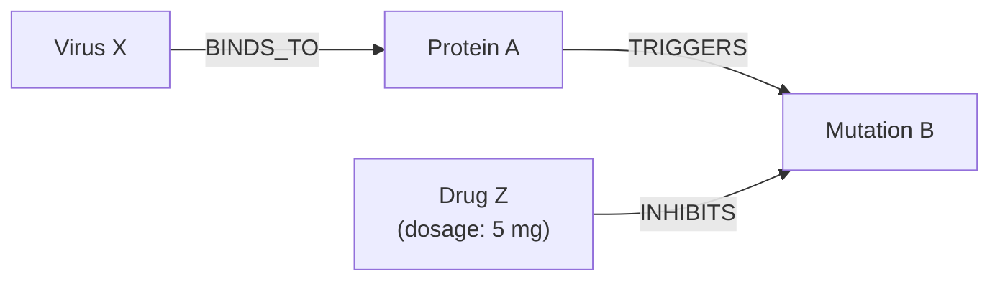
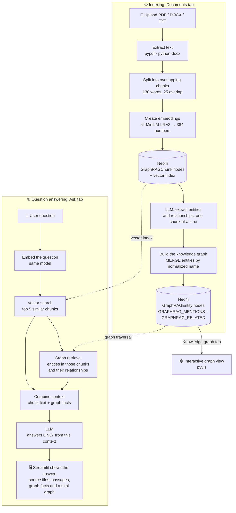

# 🕸️ GraphRAG with Neo4j, an LLM and Streamlit

A beginner-friendly **GraphRAG** web app. Upload PDF, DOCX or TXT files. The app turns them into a **knowledge graph** in **Neo4j**, and you can ask questions that are answered **only from your documents**, with source references and an interactive graph view.

- **Neo4j** stores the text, its embeddings (for search by meaning) and the knowledge graph (for following connections), all in one database.
- An **LLM** extracts entities and relationships and writes the answers. This project uses **Groq** (free tier), but you can use any LLM; see [Using a different LLM](#using-a-different-llm).

---

## Contents

1. [Why GraphRAG?](#why-graphrag)
2. [Neo4j: the graph database behind this app](#neo4j-the-graph-database-behind-this-app)
3. [How GraphRAG works](#how-graphrag-works)
4. [GraphRAG vs vector RAG](#graphrag-vs-vector-rag)
5. [Architecture of this app](#architecture-of-this-app)
6. [What is stored in Neo4j](#what-is-stored-in-neo4j)
7. [Create a free Neo4j instance](#create-a-free-neo4j-instance)
8. [Run it locally](#run-it-locally)
9. [Using the app](#using-the-app)
10. [Using a different LLM](#using-a-different-llm)
11. [Credentials and security](#credentials-and-security)
12. [Troubleshooting](#troubleshooting)
13. [Limitations](#limitations)
14. [Project files](#project-files)
15. [Sources](#sources)

---

## Why GraphRAG?

A regular (*naive*) RAG pipeline splits documents into chunks, embeds them, and at question time returns the chunks **most similar** to the question.

That breaks down when the answer is **spread across several chunks**. Take this question about a microbiology book:

> *"If a patient is infected with virus X, which drug can stop the cell mutation?"*

| Chapter | Fact |
|---|---|
| Chapter 2 | Virus X **binds to** protein A |
| Another chapter | Protein A **triggers** mutation B |
| Another chapter | Drug Z **inhibits** mutation B |

Similarity search finds chunks that mention *virus X* or *cell mutation*, but it can't **connect** them: no single chunk contains the answer (*drug Z*).

**GraphRAG** builds a **knowledge graph** from the documents, then follows its relationships: **virus X → protein A → mutation B ← drug Z**.



In a knowledge graph, the **nodes** are **entities** (people, organizations, technologies, drugs…), the **edges** are **relationships** (*binds to*, *triggers*, *inhibits*), and both can have **properties** (such as *dosage 5 mg*).

🛠️ **In this app:** we tested this exact example. The LLM extracted `Virus X -BINDS_TO-> Protein A -TRIGGERS-> Mutation B` and `Drug Z -INHIBITS-> Mutation B`, and the answer was **"Drug Z"**, with the source file cited.

---

## Neo4j: the graph database behind this app

[Neo4j](https://neo4j.com/) is a **graph database**: instead of tables, it stores things and the connections between them, exactly the shape of a knowledge graph.

| Neo4j term | Meaning | In this app |
|---|---|---|
| **Node** | A thing | Every chunk and every entity |
| **Label** | The kind of node | `:GraphRAGChunk`, `:GraphRAGEntity` |
| **Relationship** | A connection with a **type** and a **direction** | `GRAPHRAG_MENTIONS` (chunk → entity), `GRAPHRAG_RELATED` (entity → entity) |
| **Property** | A key–value detail | `name`, `type`, `text`, `embedding` |
| **Cypher** | The query language; patterns look like the graph | `(a)-[:GRAPHRAG_RELATED]->(b)` |

**Why Neo4j suits GraphRAG**

- **Relationships are stored directly**, so following a chain of facts is a quick step from node to node, with no table joins.
- **Vector search is built in**, so embeddings and the graph live in one database and one query language.
- **`MERGE`** ("find it, or create it if missing") plus uniqueness constraints keep each entity as **one** node, however many chunks mention it.
- **There's a free cloud version**, AuraDB Free; see [Create a free Neo4j instance](#create-a-free-neo4j-instance).

---

## How GraphRAG works

GraphRAG has two phases: **indexing** (building the graph) and **retrieval** (answering).

| Phase | Step | In this app |
|---|---|---|
| Indexing | **Chunking** | 130-word chunks; neighbouring chunks share 25 words |
| Indexing | **Embeddings** | `all-MiniLM-L6-v2` → 384 numbers per chunk |
| Indexing | **LLM extraction**, one chunk at a time | The LLM lists entities and relationships as JSON |
| Indexing | **Entity resolution** | *Simple:* names are normalized, so "OpenAI" and "openai." become one node (synonyms aren't merged) |
| Indexing | **Community detection** | ❌ Not implemented (kept simple) |
| Retrieval | **Vector search** finds the right area of the graph | Neo4j's vector index returns the 5 most similar chunks |
| Retrieval | **Graph traversal** builds a small subgraph | Up to 15 relationships around the entities those chunks mention |
| Retrieval | **LLM generation** | The LLM answers from the chunk text **plus** the graph facts, citing file names |

💡 **Why combine both?** Vector search finds *where* a question is about. Graph retrieval follows *connections* from there, into facts stated in other chunks. Together they let the LLM link facts that no single passage contains.

---

## GraphRAG vs vector RAG

| Use **GraphRAG** when… | Use **vector RAG** when… |
|---|---|
| Documents are **interconnected**: people, organizations and events recur across sections | Text is **stand-alone**; each passage answers on its own (e.g. an FAQ) |
| You need to **connect facts** and **trace relationships** (multi-hop questions) | You need a **direct fact look-up** |
| **Explainability** matters: answers come with the graph facts used | **Speed and cost** matter most: no LLM call per chunk |

**A good test file:** `documents/computing_ai_connected_history.pdf` was written for this. People and institutions recur across chapters, so questions need two or three hops, for example *"Who co-authored AlexNet and later co-founded OpenAI?"*

---

## Architecture of this app



*The diagram uses [Mermaid](https://mermaid.js.org/). It renders on GitHub; in VS Code, install a Mermaid preview extension.*

| File | What it contains |
|---|---|
| `rag_core.py` | All GraphRAG logic: `read_document`, `split_text`, `connect` (also creates the constraints and vector index), `store_document`, `extract_graph`, `answer_question`, plus helpers for the document list, graph view and deletion |
| `app.py` | The Streamlit interface: a sidebar for credentials and the LLM provider, and three tabs (*Documents*, *Ask questions*, *Knowledge graph*) |
| `rag.ipynb` | A notebook for learning each step separately |

---

## What is stored in Neo4j

```
(:GraphRAGChunk  {id, source, chunk_index, text, embedding, graph_status})
(:GraphRAGChunk)-[:GRAPHRAG_MENTIONS]->(:GraphRAGEntity {key, name, type})
(:GraphRAGEntity)-[:GRAPHRAG_RELATED {type}]->(:GraphRAGEntity)

Vector index:  graphrag_chunk_embeddings   (384 dimensions, cosine)
Constraints:   graphrag_chunk_id, graphrag_entity_key   (unique)
```

- **Your other data is never touched.** Every query, including deletion, only matches these `GraphRAG*` labels and `GRAPHRAG_*` relationships.
- **Safe to re-run.** Chunk IDs are a hash of file name, position and text, and `MERGE` with the constraints prevents duplicates. Uploading the same file twice stores nothing new.
- **Resumable.** Chunks are `pending` until their graph is saved (`done`). A failed chunk stays `pending` and is retried next time.
- **Separate from the notebook.** `rag.ipynb` uses different labels (`DocumentChunk`, `Entity`).

Useful Cypher (run it in the Aura console's query tool or in Neo4j Browser):

```cypher
// Show the knowledge graph
MATCH p = (:GraphRAGEntity)-[:GRAPHRAG_RELATED]->(:GraphRAGEntity) RETURN p LIMIT 100

// Multi-hop: paths of up to 3 relationships between two entities
MATCH p = (:GraphRAGEntity {key: 'virus x'})-[:GRAPHRAG_RELATED*1..3]-(:GraphRAGEntity {key: 'drug z'}) RETURN p

// Remove ALL data created by this app (nothing else). Cannot be undone.
MATCH (n) WHERE n:GraphRAGChunk OR n:GraphRAGEntity DETACH DELETE n
```

---

## Create a free Neo4j instance

**Neo4j AuraDB Free** is a cloud database that Neo4j runs for you, with nothing to install.

1. **Sign up** at [console.neo4j.io](https://console.neo4j.io).
2. **Create an instance** and choose the **Free** tier of **AuraDB**. Leave the optional settings at their defaults.
3. **Save the password straight away.** It's shown **only once**. Download the credentials file (`Neo4j-<instance-id>-Created-<date>.txt`); it contains `NEO4J_URI`, `NEO4J_USERNAME` and `NEO4J_PASSWORD`.
4. **Wait until it's running.** This usually takes a few minutes.
5. **Connect the app.** Type the three values into the sidebar, or copy those three lines into a `.env` file next to `app.py`. The key names already match.
6. **Check it** with **Test Neo4j connection** in the sidebar.

**Good to know:**
- **Limits:** the free tier holds up to 200,000 nodes and 400,000 relationships, with one free instance per account ([Neo4j docs](https://neo4j.com/docs/aura/quotas-and-limits/)). A 14-page PDF uses about 50 chunks and a few hundred entities.
- **Pausing:** an unused instance can be paused. If the app can't reach Neo4j, resume the instance in the Aura console.
- **Keep the credentials file private.** Never commit it to Git.

---

## Run it locally

**Prerequisites**
- **Python 3.10+**
- **A Neo4j database**, version 5.11+ (for vector indexes). The free AuraDB works.
- **An LLM API key**, for example a free Groq key from [console.groq.com/keys](https://console.groq.com/keys). It's optional, but without it there's no graph extraction and no written answers.

```bash
cd graph-rag
python -m venv .venv
# Windows:      .venv\Scripts\activate
# macOS/Linux:  source .venv/bin/activate
pip install -r requirements.txt
streamlit run app.py
```

The app opens at **http://localhost:8501**. The first start downloads the embedding model (~90 MB) once. Stop it with **Ctrl+C**.

**Optional:** copy `.env.example` to `.env` and fill it in. Any sidebar field you leave empty then uses the `.env` value.

---

## Using the app

1. **Sidebar.** Enter the Neo4j URI, username and password, and click **Test Neo4j connection**. Then choose the **LLM provider** and enter its API key and model.
2. **📄 Documents.** Upload PDF, DOCX or TXT files and click **Process documents**.
   - Graph extraction makes one LLM call per chunk, with a progress bar.
   - If it stops because of the provider's limits, click **Extract graph for remaining chunks** later.
3. **💬 Ask questions.** You get the **answer** with file names in [brackets], the **sources**, the **retrieved passages** and the **graph facts used**.
4. **🕸️ Knowledge graph.** Explore the graph: drag, zoom, hover, and filter by entity name.

If the documents don't contain the answer, the app replies exactly: **"I couldn't find the answer in the uploaded documents."**

---

## Using a different LLM

Choose the provider in the sidebar under **LLM provider**:

| Choice | Asks for |
|---|---|
| **Groq** (default) | Groq API key, model (default `openai/gpt-oss-20b`) |
| **LiteLLM** | Gateway URL, LiteLLM API key, model name |

### LiteLLM gateway

[LiteLLM](https://docs.litellm.ai/docs/simple_proxy) is an LLM gateway: one OpenAI-compatible endpoint in front of many providers. With a LiteLLM endpoint and key:

1. Install the client the app uses: `pip install openai`
2. In the sidebar, select **LiteLLM** and enter the **gateway URL**, your **LiteLLM API key** and a **model name** the gateway offers.
3. Click **Test LiteLLM key**.

*Optional:* set `LITELLM_BASE_URL`, `LITELLM_API_KEY` and `LLM_MODEL` in `.env` as defaults.

The LiteLLM choice also works with any other OpenAI-compatible endpoint, for example `https://api.openai.com/v1`. No gateway yet? See [running your own LiteLLM proxy](https://docs.litellm.ai/docs/simple_proxy).

---

## Credentials and security

- **Nothing is hardcoded.** Credentials come from the sidebar, or from `.env` when a field is left empty.
- **Secrets are never displayed.** Key and password fields are masked; `.env` values are never sent to the page, and error messages never include credentials.
- **Nothing is saved.** Credentials are kept in memory only while the app runs. `.env` is in `.gitignore`.

---

## Troubleshooting

| Problem | What to do |
|---|---|
| *"Neo4j rejected the username or password."* | Use the values from the Aura credentials file (the username is usually `neo4j`) |
| *"Could not reach Neo4j…"* | Check the URI (`neo4j+s://…`) and resume a paused instance in the Aura console |
| *"The LLM API key was rejected."* | Check the key for the selected provider (Groq key or LiteLLM key) |
| *"The LLM doesn't know this model name."* | Check the model name: [Groq's models](https://console.groq.com/docs/models), or a `model_name` from your LiteLLM config |
| *"The LLM's rate limit or daily quota was reached."* | Wait, then click **Extract graph for remaining chunks**. Short limits are retried automatically |
| *"LiteLLM needs the openai package"* | Run `pip install openai` |
| *"No text found in …"* | The PDF is scanned (images). Use a text-based PDF or run OCR first |
| Long `No module named 'torchvision'` tracebacks in the terminal | Harmless. `.streamlit/config.toml` turns off the file watcher that caused them; start the app from the `graph-rag` folder |
| PowerShell blocks `activate` | Skip activation and run `.venv\Scripts\python.exe -m streamlit run app.py` |

---

## Limitations

- **Simple entity resolution:** spelling variants are merged, synonyms aren't.
- **No community detection**, and only **one-step** graph traversal.
- **Speed:** one LLM call per chunk. Free tiers allow only a few chunks per minute.
- **No OCR** for scanned PDFs.
- **Deleting a document** keeps relationships between entities that other documents also mention.

---

## Project files

```
graph-rag/
├── app.py                  # Streamlit user interface
├── rag_core.py             # GraphRAG logic (no Streamlit code)
├── rag.ipynb               # Step-by-step notebook
├── documents/              # Sample documents
├── requirements.txt        # Python packages
├── .streamlit/config.toml  # Streamlit settings (file watcher off)
├── .env.example            # Template for optional credentials
├── .gitignore              # Keeps .env out of version control
└── README.md
```

---

## Sources

- [What is a graph database? (Neo4j)](https://neo4j.com/docs/getting-started/graph-database/) · [Cypher](https://neo4j.com/docs/cypher-manual/current/introduction/) · [Neo4j vector indexes](https://neo4j.com/docs/cypher-manual/current/indexes/semantic-indexes/vector-indexes/)
- [AuraDB: create an instance](https://neo4j.com/docs/aura/getting-started/create-instance/) · [quotas and limits](https://neo4j.com/docs/aura/quotas-and-limits/)
- [Groq API](https://console.groq.com/docs) · [LiteLLM proxy](https://docs.litellm.ai/docs/simple_proxy) · [LiteLLM config](https://docs.litellm.ai/docs/proxy/configs) · [virtual keys](https://docs.litellm.ai/docs/proxy/virtual_keys)
- [Streamlit](https://docs.streamlit.io/) · [sentence-transformers/all-MiniLM-L6-v2](https://huggingface.co/sentence-transformers/all-MiniLM-L6-v2)
